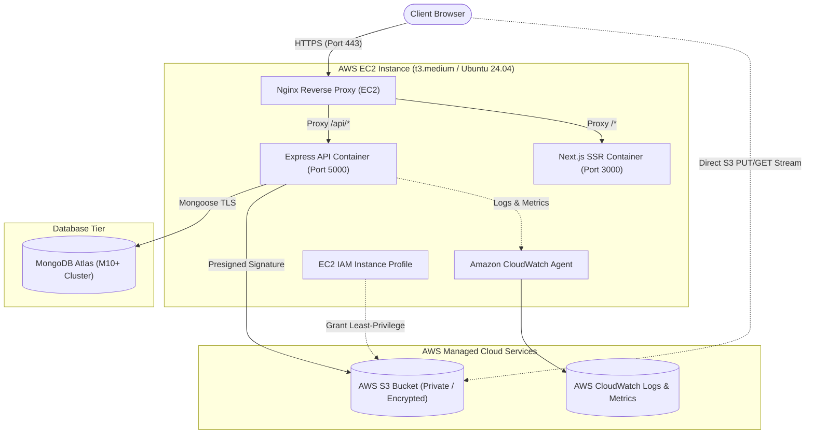

# CloudVault Production Deployment Guide (AWS EC2, S3, MongoDB Atlas & Nginx)

This runbook outlines the step-by-step production deployment strategy for **CloudVault**.

---

## 🏛️ Production Architecture Overview



---

## Step 1: AWS S3 Bucket Setup & Security

1. **Create S3 Bucket**:
   ```bash
   aws s3api create-bucket \
     --bucket your-production-cloudvault-bucket \
     --region us-east-1
   ```

2. **Block Public Access (Strict Security)**:
   ```bash
   aws s3api put-public-access-block \
     --bucket your-production-cloudvault-bucket \
     --public-access-block-configuration "BlockPublicAcls=true,IgnorePublicAcls=true,BlockPublicPolicy=true,RestrictPublicBuckets=true"
   ```

3. **Enable Default AES-256 Server-Side Encryption**:
   ```bash
   aws s3api put-bucket-encryption \
     --bucket your-production-cloudvault-bucket \
     --server-side-encryption-configuration '{
       "Rules": [{ "ApplyServerSideEncryptionByDefault": { "SSEAlgorithm": "AES256" } }]
     }'
   ```

4. **Apply CORS Configuration**:
   ```bash
   aws s3api put-bucket-cors \
     --bucket your-production-cloudvault-bucket \
     --cors-configuration file://backend/s3-cors-policy.json
   ```

---

## Step 2: AWS IAM Role & EC2 Instance Profile

Avoid storing static `AWS_ACCESS_KEY_ID` and `AWS_SECRET_ACCESS_KEY` credentials on disk. Instead, attach an IAM Role directly to the EC2 instance profile.

1. **Create the IAM Role**:
   ```bash
   aws iam create-role \
     --role-name CloudVaultEC2S3Role \
     --assume-role-policy-document file://deployment/aws/iam-trust-policy.json
   ```

2. **Attach the Least-Privilege S3 Policy**:
   - Edit `deployment/aws/iam-s3-policy.json` and replace `YOUR_BUCKET_NAME_HERE` with your actual bucket name.
   - Put the role policy:
     ```bash
     aws iam put-role-policy \
       --role-name CloudVaultEC2S3Role \
       --policy-name CloudVaultS3BucketAccess \
       --policy-document file://deployment/aws/iam-s3-policy.json
     ```

3. **Attach CloudWatch Agent Server Policy**:
   ```bash
   aws iam attach-role-policy \
     --role-name CloudVaultEC2S3Role \
     --policy-arn arn:aws:iam::aws:policy/CloudWatchAgentServerPolicy
   ```

4. **Create and Attach the Instance Profile**:
   ```bash
   aws iam create-instance-profile --instance-profile-name CloudVaultEC2Profile
   aws iam add-role-to-instance-profile --instance-profile-name CloudVaultEC2Profile --role-name CloudVaultEC2S3Role
   ```

---

## Step 3: MongoDB Atlas Setup

1. Create a MongoDB Atlas cluster (M0 free tier for testing or M10+ for production).
2. Create a database user with `readWrite` permissions on the `cloudvault` database.
3. In **Network Access**, add your EC2 Elastic IP address (or `0.0.0.0/0` during initial setup with strict password auth).
4. Note your connection string:
   ```text
   mongodb+srv://cloudvault_admin:<PASSWORD>@cluster0.abcde.mongodb.net/cloudvault?retryWrites=true&w=majority
   ```

---

## Step 4: Provision AWS EC2 Instance

1. **Launch EC2 Instance**:
   - **AMI**: Ubuntu Server 24.04 LTS (HVM), SSD Volume Type
   - **Instance Type**: `t3.medium` (2 vCPU, 4 GiB Memory) or `t3.small`
   - **IAM Instance Profile**: Select `CloudVaultEC2Profile`
   - **Storage**: 30 GiB gp3 SSD
   - **Security Group**:
     - Port 22 (SSH) - Restrict to your management IP
     - Port 80 (HTTP) - Anywhere (`0.0.0.0/0`)
     - Port 443 (HTTPS) - Anywhere (`0.0.0.0/0`)

2. **Allocate & Associate Elastic IP**:
   Allocate an Elastic IP in the AWS console and associate it with the running instance to ensure a static public IP address.

---

## Step 5: Server Preparation on EC2

SSH into the instance:
```bash
ssh -i your-key.pem ubuntu@<YOUR_ELASTIC_IP>
```

Install Docker, Docker Compose, and Git:
```bash
sudo apt-get update
sudo apt-get install -y ca-certificates curl gnupg git

# Install Docker Engine
sudo install -m 0755 -d /etc/apt/keyrings
curl -fsSL https://download.docker.com/linux/ubuntu/gpg | sudo gpg --dearmor -o /etc/apt/keyrings/docker.gpg
sudo chmod a+r /etc/apt/keyrings/docker.gpg

echo \
  "deb [arch="$(dpkg --print-architecture)" signed-by=/etc/apt/keyrings/docker.gpg] https://download.docker.com/linux/ubuntu \
  "$(. /etc/os-release && echo "$VERSION_CODENAME")" stable" | \
  sudo tee /etc/apt/sources.list.d/docker.list > /dev/null

sudo apt-get update
sudo apt-get install -y docker-ce docker-ce-cli containerd.io docker-buildx-plugin docker-compose-plugin

# Grant ubuntu user docker access
sudo usermod -aG docker ubuntu
newgrp docker
```

---

## Step 6: Clone and Deploy CloudVault

1. **Clone Repository**:
   ```bash
   git clone https://github.com/ajmalsadhiq/cloud-project.git /opt/cloudvault
   cd /opt/cloudvault
   ```

2. **Configure Production Environment Variables**:
   Create `/opt/cloudvault/.env`:
   ```env
   NODE_ENV=production
   FRONTEND_URL=https://your-domain.com
   NEXT_PUBLIC_API_URL=https://your-domain.com/api
   MONGODB_URI=mongodb+srv://cloudvault_admin:<PASSWORD>@cluster0.abcde.mongodb.net/cloudvault?retryWrites=true&w=majority
   JWT_SECRET=super_secure_random_key_production_64_characters_minimum
   JWT_EXPIRES_IN=7d
   AWS_REGION=us-east-1
   AWS_S3_BUCKET_NAME=your-production-cloudvault-bucket
   AWS_S3_PRESIGNED_URL_EXPIRES_IN=900
   DEFAULT_STORAGE_QUOTA_BYTES=1073741824
   ```

3. **Build & Start Containers**:
   ```bash
   docker compose -f docker-compose.prod.yml up -d --build
   ```

4. **Verify Container Health**:
   ```bash
   docker ps
   curl http://localhost/healthz
   curl http://localhost/api/health
   ```

---

## Step 7: Configure SSL / TLS with Certbot

To secure traffic with Free Let's Encrypt certificates:
```bash
sudo apt-get install -y certbot python3-certbot-nginx
sudo certbot certonly --webroot -w /var/lib/docker/volumes/cloud_nginx-logs/_data -d your-domain.com
```

---

## Step 8: AWS CloudWatch Agent Setup

1. **Install CloudWatch Agent on EC2**:
   ```bash
   wget https://s3.amazonaws.com/amazoncloudwatch-agent/ubuntu/amd64/latest/amazon-cloudwatch-agent.deb
   sudo dpkg -i -E ./amazon-cloudwatch-agent.deb
   ```

2. **Apply Configuration**:
   ```bash
   sudo /opt/aws/amazon-cloudwatch-agent/bin/amazon-cloudwatch-agent-ctl \
     -a fetch-config \
     -m ec2 \
     -s \
     -c file:/opt/cloudvault/deployment/aws/cloudwatch-agent-config.json
   ```

3. **Verify Metrics & Logs**:
   Open the **AWS CloudWatch Console** -> **Log Groups**:
   - `/aws/ec2/cloudvault/backend`
   - `/aws/ec2/cloudvault/nginx-access`
   - `/aws/ec2/cloudvault/nginx-error`

---

## Step 9: Zero-Downtime Updates (CI/CD)

For future updates, pull the latest code and perform a rolling build:
```bash
cd /opt/cloudvault
git pull origin main
docker compose -f docker-compose.prod.yml build
docker compose -f docker-compose.prod.yml up -d --no-deps backend frontend
```
