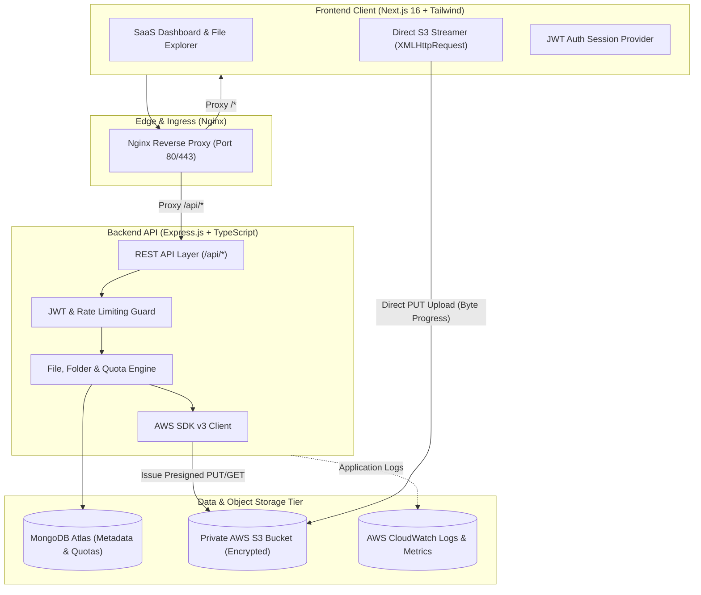

# CloudVault ☁️

[](#-automated-testing)
[](#-aws-s3-integration)
[](https://nextjs.org/)
[](LICENSE)

**CloudVault** is an enterprise-grade cloud file storage and digital asset management platform inspired by Google Drive, Dropbox, and Linear. It features direct-to-S3 presigned streaming uploads, a MongoDB-indexed virtual folder hierarchy, quota controls, real-time telemetry, and a dark/light SaaS dashboard.

---

## 🏗️ High-Level Architecture



---

## 🛠️ Technology Stack

| Layer | Technologies |
|---|---|
| **Frontend** | Next.js 16 (App Router), React 19, TypeScript, Tailwind CSS, Lucide Icons, Axios |
| **Backend** | Node.js (v22 LTS), Express.js, TypeScript, Zod Validation, Mongoose |
| **Database** | MongoDB Atlas / Local MongoDB with Compound Indexing |
| **Object Storage** | AWS S3 (AWS SDK for JavaScript v3), Presigned URLs, CORS Policies |
| **Security & Auth** | JWT Authentication, bcrypt password hashing, Express Rate Limiter, Helmet |
| **DevOps & Cloud** | Docker, Docker Compose, Nginx, AWS EC2, AWS IAM, AWS CloudWatch |

---

## ⚡ Key Platform Capabilities

1. **Direct-to-S3 Presigned Streaming**:
   - Files stream directly from the browser to Amazon S3 via time-expiring presigned PUT signatures.
   - Bypasses backend web server bottlenecks and eliminates EC2 bandwidth charges for uploads.
2. **Private S3 Objects**:
   - S3 bucket has Block Public Access enabled; files are accessible only via temporary (15-min) presigned GET URLs generated on-demand after ownership verification.
3. **Virtual Folder Engine**:
   - Nested folder trees stored in MongoDB with infinite depth, cycle detection, and dynamic breadcrumbs pathing (`Root > Folder > Subfolder`).
4. **Real-time Quota Management**:
   - Configurable storage limits (default: 1 GB); uploads exceeding quota are rejected before S3 URL generation.
5. **Real-time Byte-Level Progress**:
   - XMLHttpRequest upload monitors track direct S3 network streaming with visual progress indicators.
6. **In-Browser Previews**:
   - Instant in-browser viewer for Images (PNG, JPG, WebP) and PDFs, alongside metadata inspection (size, extension, owner, S3 storage key).
7. **Development Simulation Mode**:
   - When running locally without live AWS credentials, CloudVault operates in an explicit dev simulation mode, allowing the entire UI and API to be tested end-to-end without fake claims.

---

## 📚 Documentation Links

- 📖 **[REST API Specification (API.md)](./API.md)**: Full documentation of all 18 endpoints, query params, schemas, and responses.
- 🚀 **[AWS Production Deployment Guide (DEPLOYMENT.md)](./DEPLOYMENT.md)**: Production runbook for AWS EC2, S3, IAM Roles, CloudWatch, Nginx, and SSL Certbot.
- 🛡️ **[AWS S3 CORS Policy Template (backend/s3-cors-policy.json)](./backend/s3-cors-policy.json)**: Bucket CORS configuration for browser direct streaming.
- 🐳 **[Production Docker Compose (docker-compose.prod.yml)](./docker-compose.prod.yml)**: Multi-container orchestration (Backend + Frontend + Nginx).

---

## 🧪 Automated Testing

CloudVault includes a comprehensive automated end-to-end test suite verifying authentication, folder hierarchies, S3 presigned URL signing, quota controls, and recursive cascade deletions.

```bash
cd backend
npm run test
```

**Test Coverage Summary**:
```text
========================================================
   🧪 CloudVault Automated End-to-End Local Test Suite
========================================================
  ✅ [PASS] MongoDB database connection established
  ✅ [PASS] AuthService.register generates valid JWT
  ✅ [PASS] AuthService.register records correct email
  ✅ [PASS] Default storage quota set (1 GB)
  ✅ [PASS] Initial storage used is 0
  ✅ [PASS] Duplicate registration correctly rejected with 409 Conflict
  ✅ [PASS] AuthService.login returns token for valid credentials
  ✅ [PASS] Invalid login credentials rejected with 401 Unauthorized
  ✅ [PASS] FolderService creates root folder
  ✅ [PASS] Root folder has null parentFolderId
  ✅ [PASS] Duplicate folder name in same directory rejected with 409
  ✅ [PASS] Subfolder references parent correctly
  ✅ [PASS] Breadcrumbs calculation matches hierarchy
  ✅ [PASS] FolderService.renameFolder updates name successfully
  ✅ [PASS] Presigned upload URL generated
  ✅ [PASS] S3 key incorporates owner ID namespace
  ✅ [PASS] Uploads exceeding storage quota correctly rejected with 400 Bad Request
  ✅ [PASS] FileService.confirmUpload creates MongoDB record
  ✅ [PASS] User storageUsed incremented by file size (5 MB)
  ✅ [PASS] Presigned download URL generated with expiration
  ✅ [PASS] File moved to root directory
  ✅ [PASS] Dashboard stats reports totalFiles: 1
  ✅ [PASS] Dashboard stats reports totalFolders: 2
  ✅ [PASS] Dashboard stats reports accurate storageConsumed (5 MB)
  ✅ [PASS] Documents category count incremented
  ✅ [PASS] Recent uploads activity contains uploaded file
  ✅ [PASS] FileService.deleteFile frees file bytes
  ✅ [PASS] User storageUsed decremented to 0 after file deletion
  ✅ [PASS] Recursive folder deletion deleted parent and child folders
========================================================
   🏁 TEST RESULTS: 29 PASSED, 0 FAILED
========================================================
```

---

## 🔍 AWS S3 Diagnostic Tool

Verify your AWS credentials and bucket permissions in one command:
```bash
cd backend
npm run verify:s3
```

---

## 🚀 Local Quickstart Guide

### 1. Clone & Setup Backend
```bash
cd backend
npm install
cp .env.example .env
# Edit .env with your MongoDB URI (defaults to mongodb://127.0.0.1:27017/cloudvault)
npm run dev
```

### 2. Setup Frontend
```bash
cd frontend
npm install
cp .env.example .env.local
npm run dev
```

Open [http://localhost:3000](http://localhost:3000) to access CloudVault.

---

## 📄 License
This project is licensed under the MIT License.
